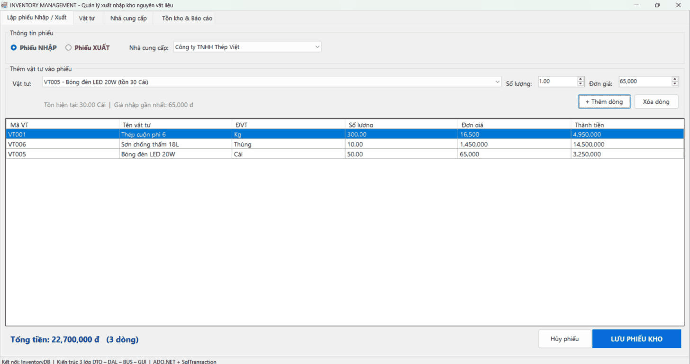
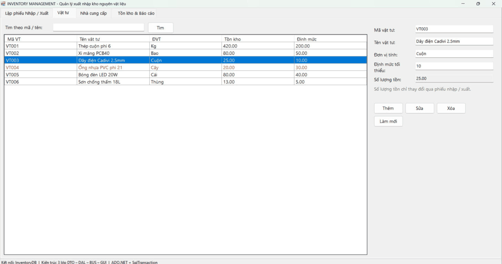
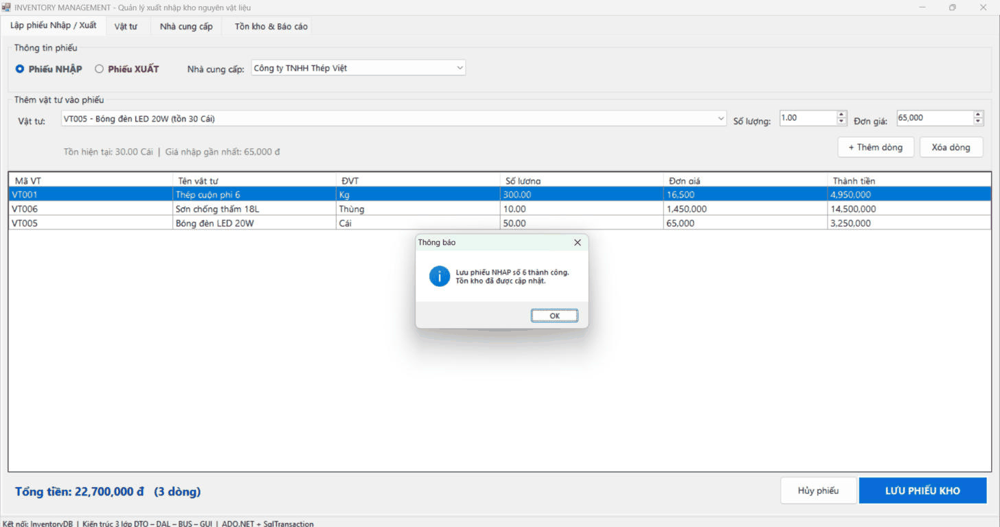
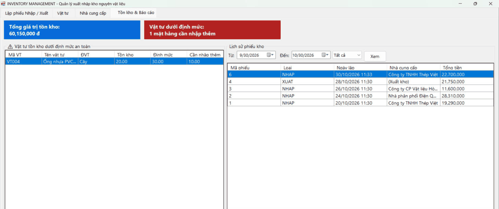
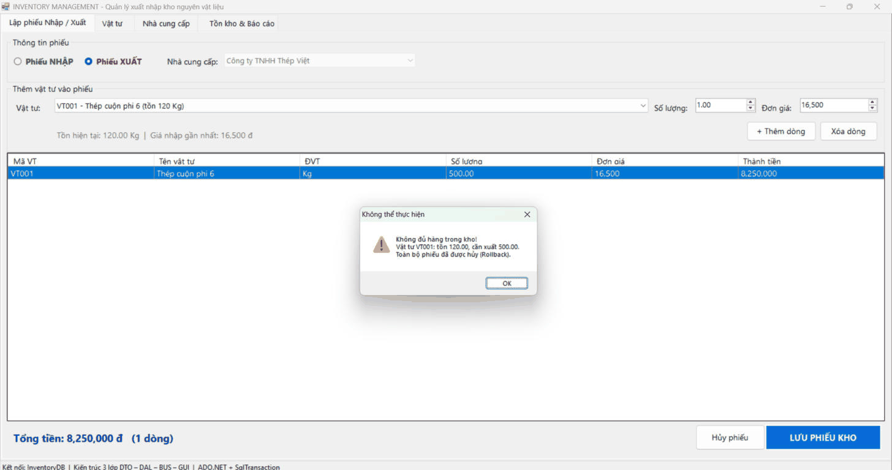

# BÀI TẬP 5.5 – HỆ THỐNG QUẢN LÝ QUY TRÌNH XUẤT - NHẬP KHO NGUYÊN VẬT LIỆU (INVENTORY MANAGEMENT)

Ứng dụng WinForms (C#, .NET Framework 4.8) kết nối SQL Server bằng ADO.NET, kiến trúc 3 lớp **DTO – DAL – BUS – GUI**.

## MỤC 1: THÔNG TIN SINH VIÊN

- **Họ và tên sinh viên:** Trần Nhật Đông
- **Mã sinh viên:** 24810320177
- **Lớp:** D19QTANM1
- **Tên Đề tài / Bài tập:** Bài 5.5 – Hệ thống quản lý quy trình xuất - nhập kho nguyên vật liệu

## MỤC 2: HƯỚNG DẪN CÀI ĐẶT & CHẠY DỰ ÁN

**Yêu cầu:** Visual Studio 2022 (workload *.NET desktop development*), SQL Server + SSMS.

1. Mở SQL Server Management Studio (SSMS), chạy file `Database/ScriptDB.sql` để khởi tạo CSDL `InventoryDB` và dữ liệu mẫu.
2. Mở file `InventoryManagement.sln` bằng Visual Studio 2022.
3. Mở file `InventoryManagement/App.config`, sửa `Data Source` trong chuỗi kết nối `InventoryDB` cho phù hợp với máy cá nhân (ví dụ `.\SQLEXPRESS` hoặc `(localdb)\MSSQLLocalDB`).
4. Build & Run dự án (F5).

## Cấu trúc thư mục

```
├── Database/
│   └── ScriptDB.sql              # Tạo CSDL InventoryDB + dữ liệu mẫu (tồn kho khớp với các phiếu mẫu)
├── InventoryManagement/
│   ├── DTO/                      # NhaCungCapDTO, VatTuDTO, PhieuKhoDTO, ChiTietPhieuKhoDTO
│   ├── DAL/                      # DatabaseHelper, NhaCungCapDAL, VatTuDAL, PhieuKhoDAL
│   ├── BUS/                      # NhaCungCapBUS, VatTuBUS, PhieuKhoBUS
│   ├── GUI/                      # FrmMain, UcPhieuKho, UcVatTu, UcNhaCungCap, UcBaoCao, UiHelper
│   ├── App.config
│   └── Program.cs
├── images/
├── README.md
└── InventoryManagement.sln
```

> Bảng `VatTu` có thêm cột `DinhMucToiThieu` (ngưỡng tồn kho an toàn) để phục vụ chức năng cảnh báo tồn kho.

## Chức năng đã thực hiện

| Yêu cầu đề bài | Cách thực hiện |
|---|---|
| Quản lý Vật tư & Nhà cung cấp (Connected Model) | Thêm / Sửa / Xóa / Tra cứu qua lớp BUS → DAL, dùng `SqlConnection` + `SqlCommand` + `SqlDataReader`. Không cho xóa vật tư / NCC đã phát sinh phiếu |
| Tìm kiếm chống SQL Injection | Tìm vật tư theo **mã hoặc tên** bằng `SqlParameter` (nhập `' OR 1=1 --` chỉ được coi là chuỗi tìm kiếm). Mọi câu lệnh khác cũng dùng SqlParameter |
| Lập phiếu Nhập / Xuất (SqlTransaction) | Chọn loại phiếu → thêm danh sách vật tư, số lượng, đơn giá → **Lưu phiếu kho**: `PhieuKhoDAL.LuuPhieuKho()` mở một `SqlTransaction` và lần lượt: (1) chèn `PhieuKho`, (2) chèn `ChiTietPhieuKho`, (3) **NHAP** cộng `SoLuongTon`; **XUAT** kiểm tra tồn, nếu `SoLuongTon < SoLuong` thì gọi `trans.Rollback()` và báo **"Không đủ hàng trong kho"**, (4) `trans.Commit()` khi tất cả thành công |
| Cảnh báo tồn kho | Danh sách vật tư có `SoLuongTon < DinhMucToiThieu`, kèm số lượng cần nhập thêm. Ở tab Vật tư, các dòng này hiện chữ đỏ |
| Tổng giá trị tồn kho | Tính bằng **`ExecuteScalar`**: Σ (SoLuongTon × đơn giá nhập gần nhất) |
| Báo cáo | Lịch sử phiếu kho theo ngày / loại phiếu và chi tiết từng phiếu |

## MỤC 3: HÌNH ẢNH KẾT QUẢ CÁC MÀN HÌNH CHỨC NĂNG

1. Màn hình Chính / Tổng quan:
   
2. Màn hình Quản lý Danh mục / Thêm Sửa Xóa (CRUD):
   
3. Màn hình Thực thi Nghiệp vụ chính (Lập phiếu nhập / xuất):
   
4. Màn hình Báo cáo - Thống kê (cảnh báo tồn kho, tổng giá trị tồn):
   
5. Minh họa báo lỗi giao dịch – xuất quá số tồn, phiếu bị Rollback:
   
